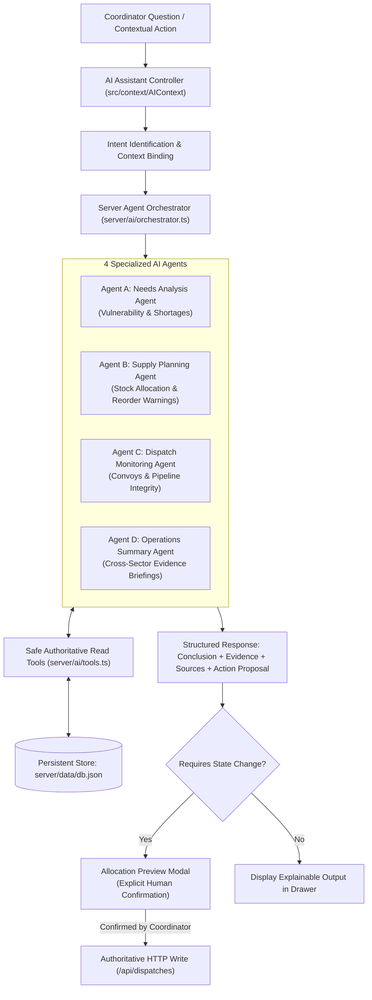

# ReliefHub — ReliefGrid Operations Console
### Sindh Flood Response Operations | AI-Assisted Humanitarian Logistics Platform

[](https://reactjs.org/)
[](https://www.typescriptlang.org/)
[](https://vitejs.dev/)
[](https://tailwindcss.com/)
[](https://expressjs.com/)
[](https://github.com/)

---

## 1. Executive Summary & Product Thesis

**ReliefHub** is a mobile-first, high-density humanitarian logistics application built to coordinate flood-relief camps across upper and lower Sindh, Pakistan, augmented by **ReliefHub Intelligence** — an explainable, multi-agent AI system.

### Non-Negotiable Core Principle
> **“A camp is not helped just because a delivery has been assigned.”**

Standard SaaS dashboards prematurely count dispatched goods as delivered fulfilment, giving relief coordinators a false sense of security while families wait empty-handed. ReliefHub strictly distinguishes three quantities for every tracked need:

1. **Delivered:** Supplies physically received and verified at the camp. Counts toward true fulfilment.
2. **Committed:** Supplies reserved in *Pending* or *In Transit* dispatches. **Does not count as delivered.**
3. **Unallocated:** Required quantity not yet delivered or reserved. The critical operational gap.

$$\text{unallocated} = \max(0, \text{required\_quantity} - \text{fulfilled\_quantity} - \text{reserved\_quantity})$$
$$\text{reserved\_quantity} = \sum (\text{Pending} + \text{In Transit dispatches for that need})$$

---

## 2. Visual Identity: *Estuary at Dawn*

Inspired by a contemporary humanitarian field atlas, ReliefHub avoids generic corporate SaaS templates:
- **Canvas (`#F3EFE6`):** Warm ecru canvas texture.
- **Surface (`#FFFCF5`):** Restrained ivory cards with subtle borders (`#DCD4C7`).
- **Ink (`#292331`):** Deep plum-slate for high-contrast, accessible typography.
- **Copper (`#A6533D`):** Primary action terracotta accent.
- **Teal (`#276660`):** Delivered physical fulfilment indicator.
- **Saffron (`#D5A441`):** Committed (in-transit/pending) supplies indicator.
- **Critical (`#A73752`):** Unmet critical gaps and low-stock alerts.
- **Tabular Numerals:** Strict numerical column alignment for all metrics.

---

## 3. Architecture & Multi-Agent Intelligence Layer



---

## 4. The 4 Specialized AI Agents

### Agent A: Needs Analysis Agent
- **Purpose:** Identifies underserved camps and explains outstanding critical gaps.
- **Operational Rules:**
  - Evaluates High-priority needs where delivered fulfilment is strictly under 40%.
  - Ranks results by lowest delivered fulfilment first.
  - Explains the exact evidence: camp, district, required, delivered, committed, and remaining gap.
  - Generates actionable next steps (e.g. *“Basti Noor Shah has a high-priority water need with 30% delivered fulfilment, 20 units committed, and 50 units unallocated. Review available water stock before creating a reservation.”*).

### Agent B: Supply Planning Agent
- **Purpose:** Assesses warehouse depot stock against field demand to formulate safe reservations.
- **Operational Rules:**
  - Identifies items below or at reorder thresholds.
  - Enforces: $\text{maximum\_dispatch} = \min(\text{available\_stock}, \text{unallocated\_need})$.
  - Detects stockouts and partial allocation feasibility.
  - Surfaces competing demands from other camps as contextual intelligence.
  - Prepares allocation proposals with Before $\to$ After impacts for coordinator review.

### Agent C: Dispatch Monitoring Agent
- **Purpose:** Investigates committed but undelivered supplies to protect logistics velocity.
- **Operational Rules:**
  - Summarizes Pending and In Transit convoys.
  - Verifies that committed supplies remain isolated from delivered totals.
  - Flags dispatches awaiting convoy movement without inventing fake ETAs, tracking coordinates, or driver details.

### Agent D: Operations Summary Agent
- **Purpose:** Prepares multi-sector operational briefings for specific districts or province-wide.
- **Operational Rules:**
  - Synthesizes camp shelter densities, depot inventory, active dispatches, and volunteer staffing.
  - **Strict Separation of Units:** Monetary contributions (PKR) and physical consignments (litres, tents, packs) are never added together into a misleading total.

---

## 5. Safe Tool Use & Human-in-the-Loop Governance

1. **Read-Only Autonomy:** Agents execute read tools automatically to retrieve authoritative facts.
2. **Prohibited Autonomous Actions:** Agents **never** autonomously create, confirm, cancel, or modify dispatches, inventory, camps, donations, or volunteer assignments.
3. **Action Proposals:** When an agent formulates an allocation recommendation, it generates an `ActionProposal` payload. The coordinator clicks **“Preview Allocation”**, inspecting the live Before $\to$ After matrix before confirming the reservation through the authoritative HTTP API.

---

## 6. Contextual AI Entry Points Across All Pages

Coordinators can access specialized intelligence directly within existing operational workflows:

| Page | Contextual AI Action Pills | Specialized Agent |
| :--- | :--- | :--- |
| **Overview** | `Explain Priority Gaps`, `Plan Allocations` | Needs Analysis & Supply Planning |
| **Camps** | `Summarize Camps Status`, `AI Insights (Per Camp)` | Operations Summary & Needs Analysis |
| **Warehouse** | `Stock Gap Analysis`, `Replenishment Audit` | Supply Planning Agent |
| **Dispatches** | `Review Pending Dispatches`, `Pipeline Integrity` | Dispatch Monitoring Agent |
| **Donations** | `Cash Aid Summary`, `In-Kind Stock Impact` | Operations Summary & Supply Planning |
| **Volunteers** | `Staffing Availability`, `Roster Audit` | Operations Summary Agent |

---

## 7. Local Installation & Startup Commands

```powershell
# Navigate to the project directory
cd "c:\Users\EURO COMPUTERS\Desktop\hackathon project\Team-CodeCrafters\submission\team_CodeCrafters\ReliefHub"

# Run both Mock API (Port 3001) and Frontend (Port 5173) concurrently
npm run dev
```

### Verified Live Endpoints
- **Frontend Operations Console:** [http://localhost:5173/](http://localhost:5173/)
- **Backend Mock REST API:** [http://localhost:3001/](http://localhost:3001/)
- **AI Agents Manifest:** [http://localhost:3001/api/ai/agents](http://localhost:3001/api/ai/agents)
- **AI Query Pipeline:** [http://localhost:3001/api/ai/query](http://localhost:3001/api/ai/query)

---

## 8. Judge & Evaluator Walkthrough Script (5-Minute Tour)

1. **Open Console:** Navigate to [http://localhost:5173/](http://localhost:5173/).
2. **Trigger ReliefHub Intelligence:**
   - Click the **ReliefHub Intelligence** launcher in the lower right.
   - Click the suggested question: *“Which high-priority needs are below 40% delivered fulfilment?”*
   - Observe the structured response: key insight, evidence bullet points with exact figures, and reference sources.
3. **Inspect Clickable Evidence Sources:**
   - Click the reference chip for *Basti Noor Shah*. Notice the **Right Inspection Drawer** opens with the live Response Gap Strip!
4. **Test Human-in-the-Loop Supply Allocation:**
   - In the assistant drawer, click the suggested prompt: *“What could we allocate with the available stock?”*
   - Notice the **Supply Planning Agent** identifies a feasible reservation for *Basti Noor Shah* and renders the **“Open Allocation Preview”** button.
   - Click **“Open Allocation Preview”** $\to$ observe the modal displays the Before $\to$ After matrix:
     - Warehouse Stock: $45 \to 0$
     - Committed: $20 \to 65$
     - Unallocated: $50 \to 5$
     - Delivered: **Unchanged (30 units)**
   - Click **“Confirm reservation”** $\to$ verify the dispatch is recorded and stock is deducted at the HTTP boundary!
5. **Inspect the Unified Agent Activity Panel:**
   - Click the activity icon in the assistant header to open the **Specialized AI Agents Console**.
   - Review live statuses for all 4 agents and trigger any agent directly.
6. **Test Contextual AI Entry Points:**
   - Navigate to **Warehouse** (`/warehouse`) and click **“Stock Gap Analysis”**.
   - Navigate to **Dispatches** (`/dispatches`) and click **“Review Pending Dispatches”**.
   - Navigate to **Volunteers** (`/volunteers`) and click **“Staffing Availability”**.
7. **Reset to Clean State:**
   - In the top header, click **Demo Guide** $\to$ **“Reset to Clean Demo State”** to restore the database to verified seed conditions.
